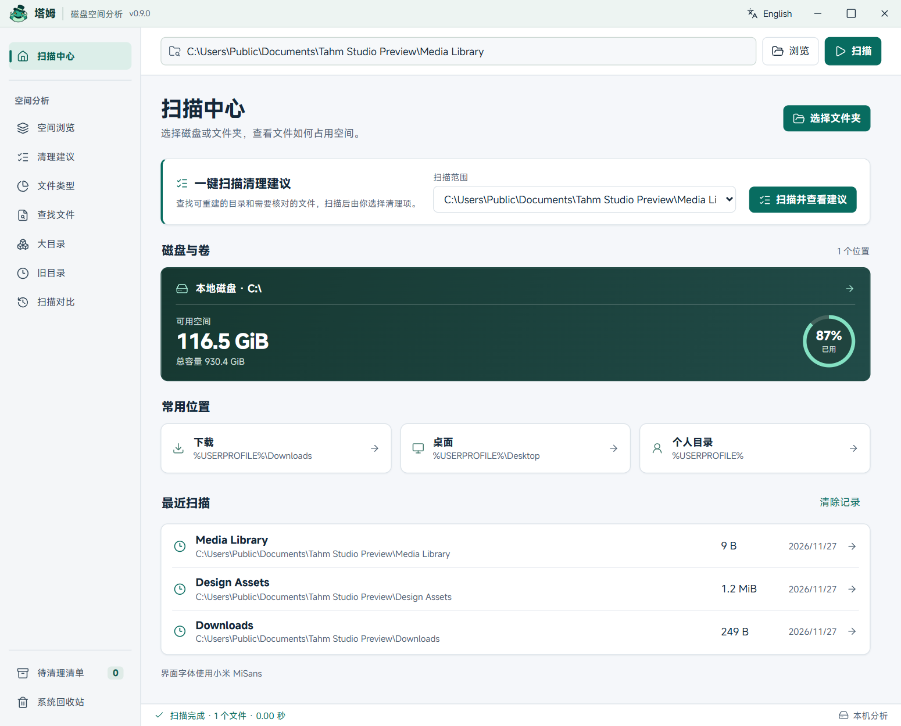

# 塔姆 · 磁盘空间分析

[English](README.en.md) · [下载最新版](https://github.com/la8garlic/Tahm/releases/latest) · [v1.0.0 发布说明](docs/releases/v1.0.0.zh-CN.md) · [安全报告](SECURITY.md)

塔姆是面向 Windows x64 的桌面文件分析工具。扫描一个磁盘或文件夹，可以找出占空间的内容、了解旧目录的用途，并在移入回收站前估算实际能释放的空间。基础分析在本机完成，离线可用。

## 下载与启动

1. 从 [Releases](https://github.com/la8garlic/Tahm/releases) 下载同一版本的 `Tahm-v1.0.0-windows-x64.zip` 和 `SHA256SUMS.txt`。
2. 在下载目录运行 `Get-FileHash .\Tahm-v1.0.0-windows-x64.zip -Algorithm SHA256`，与校验文件中的十六进制值逐字比较。
3. 解压整个 ZIP，双击 `Tahm.exe`。系统需要 Microsoft Edge WebView2 Runtime；缺少时可从 [Microsoft](https://developer.microsoft.com/microsoft-edge/webview2/) 安装。当前公开发行版没有 Authenticode 签名。
4. 在标题栏选择 **English** 或 **中文**。应用会记住选择。也可运行 `.\Tahm.exe "D:\示例目录"` 直接扫描指定目录。

## 从面积图到清理清单

- 普通扫描后点击面积图上方的 **查看清理建议**。**有重建依据** 会列出匹配了锁文件、编译器标记或对应源码的目录；**需人工判断** 单列归档、安装包和缺少重建线索的项目。若要核实两个文件内容相同，可在文件详情中选择 **查找相同内容**。[查看界面示例](docs/screenshots/cleanup-zh-CN.png)
- 在扫描中心使用 **一键扫描清理建议**。默认扫描下载目录，也可在“扫描范围”选择个人目录、磁盘或地址栏中的目录。扫描完成后按建议类别筛选，选中项目核对依据和预计释放量，再决定是否加入清单。
- 选择磁盘或文件夹开始扫描。面积图可在逻辑大小和磁盘占用之间切换，点击色块或明细行会定位另一侧对应的项目。右键色块可以打开所在目录。
- Ctrl 点选、Shift 连选，切换目录后仍保留选区。合计会合并父子项目。属于同一文件的硬链接只计一次，选区外仍有链接时，该文件的数据不会计入预计释放量。
- 在文件类型、大目录、旧目录、内容比对和扫描对比中进一步核对。加入清单后，确认才会复核并移入 Windows 回收站。发生变化或无权访问的项目会显示原因。
- 清空系统回收站后才可能收回相应空间。估算只覆盖能核实的文件主数据流；目录元数据、其他程序同时写入和回收站中原有内容会影响磁盘最终的可用空间。

## 数据与可选模型

最近八次扫描位置的汇总保存在本机，可在扫描中心清除。导出的 JSON 可能包含完整路径，请在分享前脱敏。普通扫描读取文件系统元数据；主动选择“查找相同内容”会读取候选文件内容进行比较。

选中目录并打开“模型解读用途”，可以预览将发送的目录线索，包括文件名、统计信息、修改时间和规则依据。点击发送后才会联系所选服务。支持 DeepSeek、OpenAI、Anthropic 和本机回环地址上的兼容服务。可在界面输入密钥，或在启动前设置 `DEEPSEEK_API_KEY`、`OPENAI_API_KEY`、`ANTHROPIC_API_KEY`。请勿将密钥写入仓库。模型的建议需要用户判断，无法代替对备份和软件依赖的确认。

## 构建与参与

使用 Rust、Tauri 2、React、TypeScript 和 Vite。Windows 构建工具、字体准备和可复现的命令见[贡献指南](CONTRIBUTING.md)。仓库提供[安全政策](SECURITY.md)、[行为准则](CODE_OF_CONDUCT.md)和[维护与发布流程](docs/maintenance.zh-CN.md)。

## 许可

项目代码采用 [Apache-2.0](LICENSE)。小米 MiSans VF 遵循[单独的字体协议](web/public/licenses/MiSans.pdf)，构建工具从官方包取得并校验字体，桌面程序内嵌完整字体。其他依赖的许可和来源列在发行包的 `licenses/` 中。详见 [NOTICE](NOTICE)。
